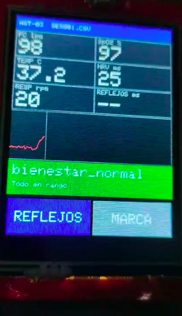

# Aerospace Health

Constant monitoring of a crew member's health with real tools, evaluated in real time. That is the core of the system.
Three resources complement it by interpreting what the monitoring produces: the medical team on the ground, a language
model, and an on-board alert engine for the moments when neither of the first two can be reached.



## What it does

**Monitoring with real tools**

- A crew monitor that draws ECG, pulse plethysmography, continuous arterial pressure and respiration in real time, with
  temperature, interstitial glucose, cabin environment and radiation.
- A touch TFT unit beside the crew member (pictured): vital signs, a wellbeing band, a live trace and touch entry such
  as a reflex test and an event mark. Its firmware is not part of this repository yet.
- Interconnection APIs: readings arrive over HTTP, a live stream, TCP, a serial port or a WebSocket.
- Room for new sensors: the evaluation already has a place for 176 variables in 28 clinical domains, so adding a sensor
  means sending its reading.
- Interfaces that fit the device, from a 320 x 240 screen to a desktop monitor, in Spanish (default) and English.

**Real-time evaluation**

- Every reading is evaluated as it arrives, over the time window that is clinically right for it, and ends in one of
  five triage levels.
- A full evaluation runs the whole case on demand and reports findings, signals to verify and what is still missing.
- What the crew member reports is evaluated too: psychological wellbeing records and a pain body map that turns a
  marked zone into an anatomical region and a medical term.

**Three complements**

- **Medical team on the ground.** A separate console with the crew directory, live dashboards, profiles and direct
  messaging in both directions.
- **Language model.** The "Astronaut Healer" assistant interprets a compact biometric package. It is always a real
  model: if none is available it says so and never gives a scripted reply.
- **Alert engine.** 211 clinical rules and a four-model machine-learning ensemble that run on board with no external
  dependency. It is one more resource, not the centre: it earns its place when there is no doctor and no language model.

> **Research prototype. Not a medical device.** It does not diagnose or prescribe. In demo mode all signals are simulated.

## AI assistance disclosure

**The code in this repository was developed with the assistance of generative AI tools (including Anthropic's Claude),
under human direction.** AI-generated code can contain errors; nothing here has been clinically validated, and the
machine-learning ensemble was trained on synthetic data only. Do not use this software for any real medical decision.
See [AI_DISCLOSURE.md](AI_DISCLOSURE.md).

## Quick start

```bash
./iniciar.sh              # first run creates .venv and installs requirements.txt   (Windows: iniciar.bat)
```

Then open:

| Address | What it is |
| --- | --- |
| `http://127.0.0.1:8777/` | Crew monitor |
| `http://127.0.0.1:8777/medico` | Ground flight surgeon console |

Requires Python 3.10+ and a recent Chrome or Edge. The page also opens without the server (double-click `web/index.html`),
with a simpler built-in engine and no assistant or ground link.

### Language-model key

The assistant uses the Groq API (`openai/gpt-oss-120b`) through the server. **No API key is included in this repository.**
Copy `.env.example` to `.env` and set `GROQ_API_KEY`, or paste the key in Options › Assistant. `.env` is git-ignored;
never commit it. A local OpenAI-compatible model (Ollama, llama.cpp, LM Studio) can be used instead.

## Repository layout

| Path | Contents |
| --- | --- |
| `servidor.py` | Minimal HTTP server (standard library only): serves the pages, exposes the engine, bridges the language model and relays crew-to-ground messages. |
| `motor/` | The alert engine: rule catalog, sliding windows, ensemble and fusion. |
| `modelos/` | The trained ensemble. |
| `web/` | The built pages: `index.html` (crew monitor) and `medico.html` (ground console). |
| `web_src/` | Sources of the pages and the build scripts (`armar.py`, `armar_idioma.py`). |
| `docs/` | User guide (PDF, Spanish), a 10-paragraph summary, the full Spanish documentation and a photo of the touch TFT unit. |

## Documentation

- [docs/Aerospace_Health_Guia_de_uso.pdf](docs/Aerospace_Health_Guia_de_uso.pdf): 20-page user guide (Spanish).
- [docs/GUIA_CORTA.md](docs/GUIA_CORTA.md): short guide in ten paragraphs (Spanish), also as [PDF](docs/Aerospace_Health_Guia_corta.pdf).
- [docs/RESUMEN.md](docs/RESUMEN.md): what the system does, in ten paragraphs (Spanish).
- [docs/README.es.md](docs/README.es.md): technical documentation, server API and signal formats (Spanish).

## How the alert engine works

The engine is the resource that keeps evaluating with no ground link and no language model.

1. **Windows.** Each signal is summarized over the window its rule requires (2 and 5 min for SpO2, 15 min for blood
   pressure and glucose, 1 h for cabin CO2).
2. **Rules.** Every rule ends in an explicit state: triggered, to verify (sensor in doubt), not computable (missing data)
   or not applicable (mission phase). Unmeasured is never read as normal.
3. **Ensemble.** Random forest, extra trees, histogram gradient boosting and gradient boosting, blended by a soft vote
   whose weights minimize log-loss on a validation set, then temperature-scaled on a separate calibration set.
4. **Fusion.** The higher level wins. The ensemble can only raise the level, and a raise is flagged as a suggestion to
   confirm.

## License

No license file is included yet. Until one is added, the default copyright rules apply.
